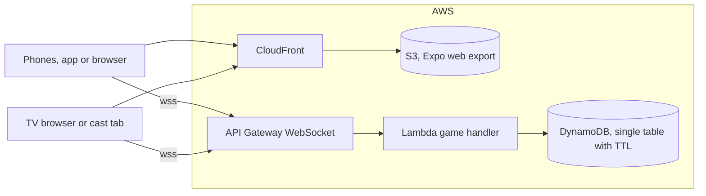

In The Name Game, everyone secretly writes down a famous person or someone the
whole room knows. Players take turns guessing who wrote which name, and a
correct guess pulls that player and their whole team onto yours. The first team
to hold everyone wins.

The paper version has one flaw: whoever reads the names aloud recognizes the
handwriting. Whose Name? replaces the paper. Players join a room from their
phones with a code or a QR code, submit names in secret, and the host's phone or
a TV shows the shuffled list with no link to who wrote each one.

- No accounts. A player's identity lasts for one game.
- Guests play in a mobile browser, so nobody has to install anything first.
- Any smart TV browser, Chromecast tab, or AirPlay screen can show the game.

## How it is built

One Expo codebase builds the web app, the iOS app, and the Android app. The TV
view is just another web route. The backend is serverless, so it costs close to
nothing when nobody is playing and game state survives deploys and phones going
to sleep.

The server is authoritative. It holds the full room state and pushes each
client its own redacted view, so who wrote what never appears in network
traffic until the game ends.

## One pure rules engine

The client and server live in one npm-workspaces monorepo and share a typed
protocol and a single rules engine. The engine is a pure
`apply(state, action)` function with no I/O, unit tested exhaustively.

On every message, the Lambda loads the room, applies the action, and writes it
back conditionally on a version number. Two players acting at the same moment
cannot silently overwrite each other, because the second write is rejected
rather than applied to stale state. The same handler also runs behind a plain local WebSocket server
with an in-memory store, so development needs no AWS at all.

## Ephemeral by design

Rooms expire through DynamoDB TTL 24 hours after their last activity, and
nothing about a player outlives the game. The App Store privacy label can
honestly say "Data Not Collected".

| Item | Cost at hobby scale |
| --- | --- |
| WebSocket messages for an 8 player game | About $0.0003 |
| Lambda and DynamoDB | Free tier, then pennies |
| S3, CloudFront, and Route 53 | About $1 a month |

## How it ships

Infrastructure is AWS CDK in its own stack, bootstrapped with a separate
qualifier and deployed through a GitHub OIDC role, so there are no long-lived
keys in CI and its deploys cannot touch other projects in the account. As in
the I Want My MTG repositories, the version number comes from the pull request
title, so a merge decides its own release.
